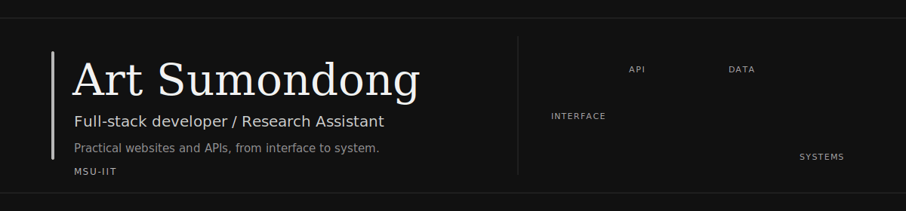
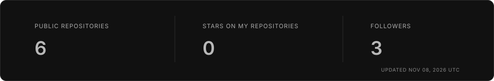

  

  <a href="https://rturooow.github.io/Art-The-Great/">Portfolio</a> &nbsp;|&nbsp;
  <a href="https://www.linkedin.com/in/art-sumondong-83419640b/">LinkedIn</a> &nbsp;|&nbsp;
  <a href="mailto:artsumondong7@gmail.com">Email</a>

## About

Hi, I'm Art Sumondong - an MSU-IIT student, Research Assistant, and full-stack developer. I enjoy building practical websites and APIs, with care for both the interface people use and the systems behind it.

I'm growing my experience across JavaScript, TypeScript, databases, Docker, and deployment, and I like turning ideas into clean, useful projects.

## Experience

- **Research Assistant - MSU-IIT** - Jul 2026-Present
- **Backend Developer Intern - meldCX** - Jan-May 2026

## Tech I use and explore

  

## Featured work

### ARTURO Portfolio

A personal portfolio built with Next.js and React to share my experience, work, and contact details. It includes an interactive project gallery and a direct contact form.

[View the live portfolio](https://rturooow.github.io/Art-The-Great/) | [Browse the source](https://github.com/rturooow/Art-The-Great)

## GitHub activity

  

  

Updated daily · <a href="https://github.com/rturooow?tab=overview">View the full contribution calendar</a>

## Connect

- **Email:** [artsumondong7@gmail.com](mailto:artsumondong7@gmail.com)
- **LinkedIn:** [linkedin.com/in/art-sumondong-83419640b](https://www.linkedin.com/in/art-sumondong-83419640b/)
- **GitHub:** [github.com/rturooow](https://github.com/rturooow)
